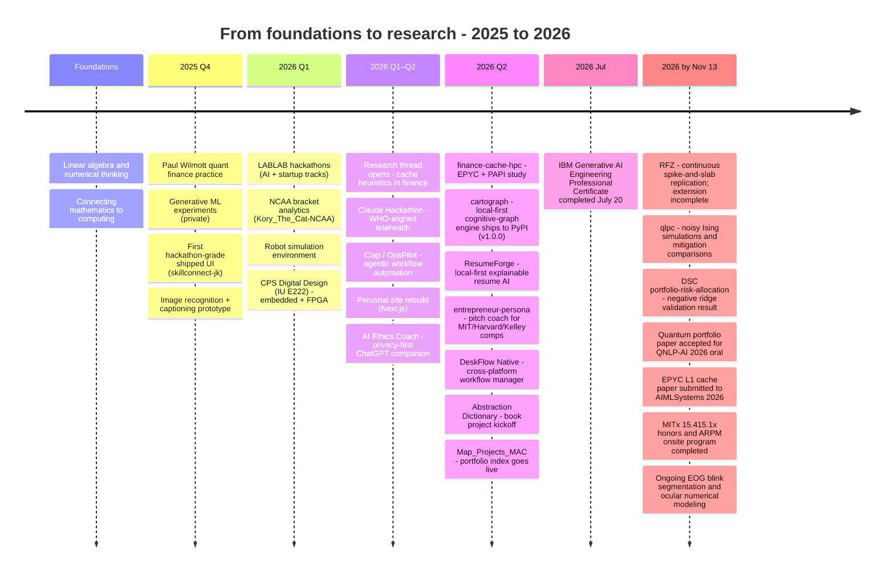

<!-- ═══════════════════════════════════════════════════════════════════════ -->
<!--  Profile README - pbathuri                                              -->
<!--  Assets served from github.com/pbathuri/Map_Projects_MAC/Assets/        -->
<!--  Auto-generated SVGs: Platane/snk + lowlighter/metrics (.github/wfs)    -->
<!-- ═══════════════════════════════════════════════════════════════════════ -->

<!-- ── Hero banner (animated GIF, static PNG fallback via object tag) -->

  

<!-- ── Typing headline ─────────────────────────────────────────────────── -->

 

<!-- ── Connect row ─────────────────────────────────────────────────────── -->

 

---

### About

I'm an **undergraduate researcher and systems builder** working at the intersection of **high-performance computing, quantitative finance, and machine learning**. My current work spans cache behaviour of financial kernels, Bayesian factor-model replication, noisy quantum simulations, and reproducible research tooling.

I'm drawn to problems where the maths, the hardware, and the market all have a vote. I build a lot. I read a lot. I ship the things I read about.

> Pursuing dual **BS degrees in Computer Engineering and Mathematics (Program II)** at **Indiana University**, expected **May 2028**. Undergraduate research with **Yuxi Hong** and, in optometry, **S. P. Srinivas**.

As of **November 13, 2026**: completed the [IBM Generative AI Engineering Professional Certificate](https://coursera.org/verify/professional-cert/N2THROL6PALV) (July 20, 2026), **MITx 15.415.1x with honors**, and the **ARPM Bootcamp onsite certificate of completion**.

---

### Research interests

<table>
<tr>
<td width="33%" valign="top">

#### 📊 Quant finance & HPC
Empirical cache characterisation of Monte Carlo, Cholesky, GARCH, and GEMM on AMD EPYC. PAPI counters, Bayesian factor models, and reproducible numerical experiments.

</td>
<td width="33%" valign="top">

#### 🧠 Foundation models for markets
Transformer architectures on financial time series, training-data effects, and predictive pipelines tested out-of-sample, including negative results rather than assumed trading value.

</td>
<td width="33%" valign="top">

#### 🛠️ Agentic systems & tooling
Local-first cognitive graphs and a model-agnostic personalization layer that steers any agent (Claude, Cursor, ChatGPT) to a user's own work - hybrid retrieval, learned ranking, and the evaluation harnesses that keep it honest.

</td>
</tr>
</table>

---

### Stack

 

---

### Timeline - how I got here

The through-line: **learn by building, measure before tuning, ship the thing**. Public repositories document selected work; private projects are labeled below.

---

### 🔬 Currently working on

- [`regime-factor-zoo`](https://github.com/pbathuri/regime-factor-zoo) - public replication of the continuous spike-and-slab estimator in Bryzgalova, Huang, and Julliard (2023), using 51 factors and 60 portfolios. BMA risk prices match to approximately `1e-14` maximum absolute difference under the authors' code and seed convention. The extension is incomplete; the matched-size permutation null has not been run, so robust factor-change claims are not established.
- [Quantum numerical methods](https://github.com/pbathuri/qlpc/tree/main/noisy_qubit_numerics) - device-calibrated 4/6/8-qubit Ising simulations, comparing readout correction and zero-noise extrapolation at a fixed shot budget. Quadratic extrapolation loses to linear in 38 of 54 comparisons. [Study write-up](https://github.com/pbathuri/qlpc/blob/main/noisy_qubit_numerics/WRITEUP.pdf). Simulation only, not a hardware speedup; the original QLPC prototype returns CVaR classically.
- [`portfolio-risk-allocation`](https://github.com/pbathuri/portfolio-risk-allocation) - public DSC study on 536 UCI ISE observations (2009-2011). Ridge validation zero-mean R² is **-0.079**, with 103 final observations reserved; this does not demonstrate a profitable strategy.
- **Optometry research with S. P. Srinivas** - ongoing EOG blink segmentation, participant-separated evaluation, and ocular numerical modeling; research methods, not clinical claims.
- [`cartograph`](https://github.com/pbathuri/cartograph) - a local-first personal cognitive graph you point at your own files; a model-agnostic personalization layer steers any AI agent (Claude · Cursor · ChatGPT) to *your* work via MCP · shipped **v1.0.0** · `pip install cartograph__v1`
- [`finance-cache-hpc`](https://github.com/pbathuri/finance-cache-hpc) - L1 cache characterisation of four quant kernels on AMD EPYC using PAPI
- [`Research_HPC_QFinance_Cache`](https://github.com/pbathuri/Research_HPC_QFinance_Cache) - the broader research thread this sits inside
- **QuantumMCL-Spring26** - *(private)* heuristic cache mechanisms for finance workflows
- **ResumeForge** - *(private)* local-first, explainable resume tailoring with LaTeX + Overleaf sync

**Papers**

- *Training Data Set Effects in LLM-Assisted Quantum Portfolio Optimization* - **Accepted for an oral presentation, QNLP-AI 2026**.
- *Empirical L1 Cache Characterization of Quantitative Finance Kernels on AMD EPYC Zen 2* - **Submitted to ACM AIMLSystems 2026**. [Code and study materials](https://github.com/pbathuri/finance-cache-hpc).

---

### Selected work

<table>
<tr><th align="left">Area</th><th align="left">Project</th><th align="left">What it does</th></tr>

<tr><td rowspan="3"><b>🔬 Quant & HPC research</b></td>
<td><a href="https://github.com/pbathuri/finance-cache-hpc">finance-cache-hpc</a></td>
<td>Empirical L1 cache study of Cholesky · Monte Carlo · GARCH · GEMM on EPYC · PAPI counters</td></tr>
<tr><td><a href="https://github.com/pbathuri/Research_HPC_QFinance_Cache">Research_HPC_QFinance_Cache</a></td><td>Research notes & experiments on improving cache behaviour in finance workflows</td></tr>
<tr><td><a href="https://github.com/pbathuri/regime-factor-zoo">regime-factor-zoo</a></td><td>Continuous spike-and-slab estimator replication on 51 factors / 60 portfolios; extension incomplete, matched-size permutation null unrun</td></tr>

<tr><td rowspan="5"><b>🧠 ML systems</b></td>
<td><a href="https://github.com/pbathuri/cartograph">cartograph</a></td>
<td>Local-first cognitive graph + model-agnostic personalization that steers any agent to your work · hybrid retrieval · query-contextual ranking · MCP · <code>pip install cartograph__v1</code></td></tr>
<tr><td>ResumeForge 🔒 (private)</td>
<td>Local-first explainable resume tailoring · LangGraph · LaTeX · Overleaf sync</td></tr>
<tr><td><a href="https://github.com/pbathuri/Claude_Hackathon">Claude_Hackathon</a></td><td>WHO-aligned telehealth intake with a self-evolving medical knowledge graph</td></tr>
<tr><td><a href="https://github.com/pbathuri/convo-ai">convo-ai</a></td><td>Duolingo-style conversation practice - Next.js + Streamlit</td></tr>
<tr><td><a href="https://github.com/pbathuri/ai-ethics-coach">ai-ethics-coach</a></td><td>Privacy-first Chrome extension - prompt coach, response auditor, energy awareness</td></tr>

<tr><td rowspan="2"><b>🎯 Entrepreneurship</b></td>
<td><a href="https://github.com/pbathuri/entrepreneur-persona-skill">entrepreneur-persona-skill</a></td>
<td>AI pitch coach - 75+ judge Qs, 8 verticals, Clapp-style proposals, 12-slide decks</td></tr>
<tr><td><a href="https://github.com/pbathuri/entrepreneur-persona-llm">entrepreneur-persona-llm</a></td><td>Model-agnostic version - ChatGPT / Gemini / Cursor / Copilot / Claude</td></tr>

<tr><td rowspan="2"><b>🏆 Hackathons & competitions</b></td>
<td><a href="https://github.com/pbathuri/LABLAB-Hackathon">LABLAB-Hackathon</a></td>
<td>Captain Whiskers - AI trading agent</td></tr>
<tr><td><a href="https://github.com/pbathuri/Kory_The_Cat-NCAA">Kory_The_Cat-NCAA</a></td><td>NCAA bracket modelling · tiered ensemble + Hungarian assignment</td></tr>

<tr><td rowspan="2"><b>🖥️ Systems & embedded</b></td>
<td>deskflow-native 🔒 (private)</td>
<td>Cross-platform (macOS + Windows) workflow manager - named profiles, non-destructive shortcuts</td></tr>
<tr><td><a href="https://github.com/pbathuri/CPS-Digital-Design">CPS-Digital-Design</a></td><td>IU E222 coursework - Raspberry Pi sensors, MQTT, SystemVerilog FPGA</td></tr>

</table>

🔒 = private · full index → <a href="https://github.com/pbathuri/Map_Projects_MAC">Map_Projects_MAC</a>

---

### Activity & metrics

<!-- ── Lowlighter metrics - auto-generated by .github/workflows/metrics.yml ── -->

 

 

<!-- ── Stats triptych ───────────────────────────────────────────────────── -->

 

 

<!-- ── Snake activity graph - auto-generated by .github/workflows/snake.yml ── -->

 

---

### Reading list (what's on my desk right now)

<table>
<tr><td><b>HPC / microarchitecture</b></td><td>Jim Handy - <i>The Cache Memory Book</i> · Balasubramonian & Jouppi - <i>Multi-Core Cache Hierarchies</i> · AMD EPYC architecture manuals</td></tr>
<tr><td><b>Quant finance</b></td><td>Velu, Hardy, Nehren - <i>Algorithmic Trading and Quantitative Strategies</i> (Chapman & Hall) · Wilmott - <i>Quantitative Finance</i> · Ruppert - <i>Statistics and Data Analysis for Financial Engineering</i></td></tr>
<tr><td><b>ML & systems</b></td><td>Fregly - <i>AI Systems Performance Engineering</i> · ISLR · deep-dive papers on KV-cache, flash attention, speculative decoding</td></tr>
</table>

---

### Following / studied

Repos I've cloned to dissect, not to fork. Honest credit goes to the upstream authors:

- **HPC / quant** - [NVIDIA/cutlass](https://github.com/NVIDIA/cutlass) · [siboehm/SGEMM_CUDA](https://github.com/siboehm/SGEMM_CUDA) · [KxSystems/kdb-taq](https://github.com/KxSystems/kdb-taq)
- **ML systems** - [karpathy/arxiv-sanity-lite](https://github.com/karpathy/arxiv-sanity-lite) · [openai/parameter-golf](https://github.com/openai/parameter-golf) · [Zjh-819/LLMDataHub](https://github.com/Zjh-819/LLMDataHub)
- **Agents / personal tooling** - [AmitSubhash/autolog](https://github.com/AmitSubhash/autolog) · [msitarzewski/agency-agents](https://github.com/msitarzewski/agency-agents)
- **Coursework** - [Developer-Y/cs-video-courses](https://github.com/Developer-Y/cs-video-courses) · [Strang EE16A notebooks](https://github.com/sstd521/Introduction-to-Linear-Algebra-5th-Edition---EE16A) · [IBM Watson NLP template](https://github.com/ibm-developer-skills-network/oaqjp-final-project-emb-ai)

Full list with annotations → [Following.md](https://github.com/pbathuri/Map_Projects_MAC/blob/main/Following.md)

---

### Philosophy

> *Curiosity is the unit. Everything else - papers read, kernels tuned, repos shipped - is just accumulated interest on it.*

I think the best researchers are the ones who can also build, and the best builders are the ones who read the papers. I try to be useful on both sides of that line.

---

Browse the full map → <a href="https://github.com/pbathuri/Map_Projects_MAC"><b>Map_Projects_MAC</b></a> · Assets → <a href="https://github.com/pbathuri/Map_Projects_MAC/tree/main/Assets"><b>/Assets</b></a>

